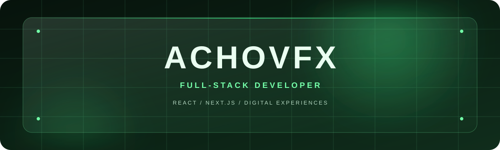
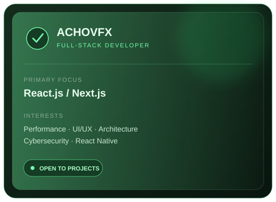
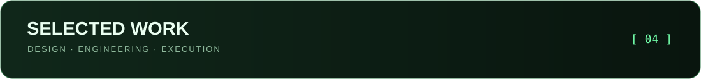
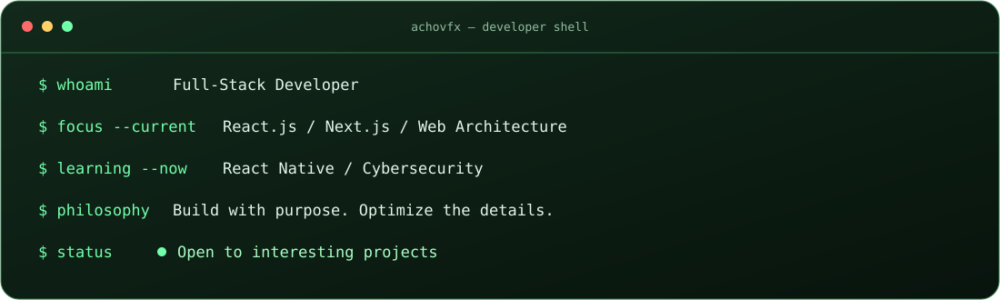

  

   

  

  

    

  <a href="https://achovfx.ir">
    **Explore my portfolio, featured projects and creative work →**
  </a>

---

  

  
  

---

<h2 align="center">01 / ABOUT ME</h2>

  

 

I'm a **Full-Stack Web Developer** passionate about building modern, scalable and visually engaging web applications.

My main focus is the React ecosystem, especially **React.js and Next.js**. I enjoy turning ideas into functional products, creating custom user interfaces and developing complete web experiences.

- 💻 Focused on Full-Stack Web Development
- ⚛️ Specialized in React.js and Next.js
- 🎨 Passionate about UI/UX and interactive experiences
- 🚀 Interested in performance, scalability and clean architecture
- 📱 Currently exploring React Native
- 🔐 Interested in Cybersecurity

 

  

---

<h2 align="center">02 / TECH STACK</h2>

  **Frontend Development**

  

    

  **Backend Development & Database**

  

    

  **Tools & Workflow**

  

---

<h2 align="center">03 / SELECTED PROJECTS</h2>

  

 

### 🌐 Personal Portfolio
My personal portfolio showcasing my development skills, projects and creative work.

- **Website:** [achovfx.ir](https://achovfx.ir)
- **Technologies:** Next.js, React.js, Tailwind CSS, GSAP

### 🍔 Restaurant Ordering System
A full-stack online food ordering platform with authentication, product management, shopping cart and order processing.

- **Technologies:** Next.js, React.js, MongoDB, Tailwind CSS

### 🏢 KLL Corporate Website
A corporate website focused on modern visual presentation, content management and responsive design.

- **Live Demo:** [kll-remake.vercel.app](https://kll-remake.vercel.app)
- **Technologies:** Next.js, React.js, MongoDB

### 🎮 Gaming & Interactive Projects
Interactive web experiences and game-related projects built with modern frontend technologies.

- **Repositories:** [Explore GitHub Repositories](https://github.com/achovfx?tab=repositories)
- **Technologies:** React.js, JavaScript, GSAP

 

  

---

<h2 align="center">04 / GITHUB STATISTICS</h2>

  

  

    

  

    

  

---

<h2 align="center">05 / CURRENTLY BUILDING</h2>

  

---

<h2 align="center">06 / CONNECT WITH ME</h2>

  

  

  

  

 

  **Have an idea or a project in mind? Let's build something great.**

  

    

  

